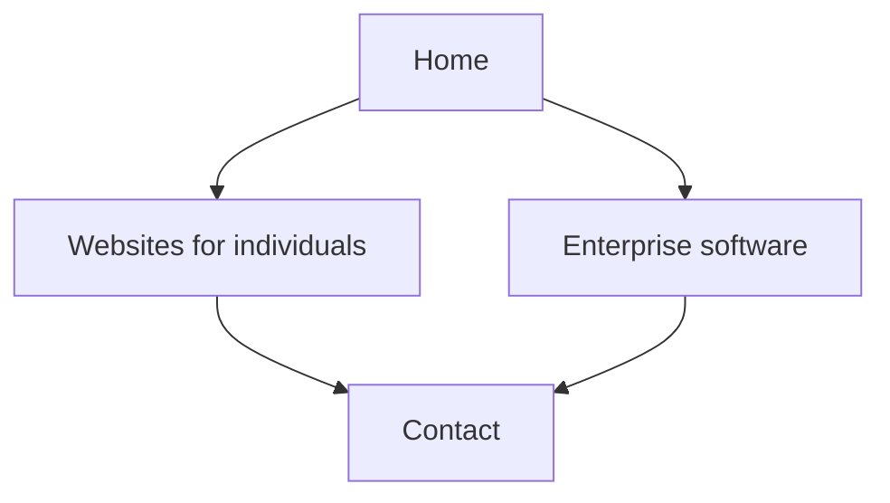

# NisCorp AI company site

Status: original brief. Living requirements are in `prd/niscorp-company-site.md`. Update that file, and add a revision-log line, when scope changes. Do not start the app until a coding agent is asked to implement the PRD.

This document is the build brief the PRD was written from. Content and positioning below override a generic company-site template. The stack is a static Next.js site with JSON content. There is no backend.

## What this site is for

NisCorp AI builds software solutions and consults on that work. This website is the company. Aperio is a separate product site later. This site does not name Aperio, link to it, or give it a section.

The company line stays general: software solutions and consulting. Two examples make that concrete, so a visitor can choose a direction:

- **Websites for individuals.** Sites for a person and their practice or private work. A doctor’s practice is one kind of client, written inside this page, not as its own brand. SEO and digital marketing are part of this work and are named as services. The page says what the client gets: a site that explains who they are, a clear way for people to reach them, and search and marketing set up around that site.
- **Enterprise software.** Software built for a company to improve how it runs its operations. The page describes that kind of engagement: understand the operation, build the software around it, and leave the team with a system they use. No product name.

Tone is pragmatic. Specific and calm. No hype words, no fake proof, and no public apologies that shrink the offer. Do not write “limited” in front of SEO or marketing. Do not mention partners, subcontractors, or combining with other firms.

## Out of scope for v1

- Aperio, by name or by section
- A product catalog and dynamic `[slug]` offering routes
- CSV ingestion and `papaparse`
- App Router `app/sitemap.ts` and `app/robots.ts` (sitemap and robots come from `next-sitemap` instead)
- Blog, pricing table, team page, testimonials, client logos, counters, newsletter
- Any server, database, route handler, server action, or third-party form backend
- Review or aggregate-rating JSON-LD
- Downloading or reskinning a BootstrapMade theme

## Pages



- **Home** (`/`): NisCorp AI builds software and consults. Two example cards (individual websites, enterprise operations software), a short sequence for how a job starts (you tell us the work, we propose it, we build it), and phone, email, and WhatsApp.
- **Websites** (`/websites`): websites for individuals, with SEO and digital marketing. Close with the same three contact actions.
- **Enterprise** (`/enterprise`): enterprise software that improves operations. Same contact close.
- **Contact** (`/contact`): phone, email, WhatsApp, and a short form (name, email, path, message). Paths: an individual website, enterprise software, or something else.

Header and footer on every page. Footer repeats the two examples and the three contact methods. A floating WhatsApp button sits on every page.

Keep these four explicit routes. Offering copy still lives in JSON. Add `app/offerings/[slug]` only when a third offering exists.

## Contact

No backend and no form service. The site cannot receive a form into an inbox by itself. Quick contact is three links, all driven from `data/company.json`:

- **Phone:** `tel:` link, number shown as people dial it.
- **Email:** `mailto:` link, address shown on the page.
- **WhatsApp:** `https://wa.me/<E.164 without plus>?text=...` so a tap opens WhatsApp (app on phone, WhatsApp Web on desktop). The floating button uses the same number, with the default message from the JSON file.

The contact form does not post anywhere. Submit opens WhatsApp with the visitor’s name, path, and message filled in. A second action opens the same text in the visitor’s email app. One line on the contact page says the message opens in WhatsApp or email on their device.

Real email and WhatsApp number are required before publish. Until they are supplied, `data/company.json` holds obvious placeholders such as `hello@example.com` and `910000000000`. Do not invent a number, address, or founder name.

## Stack

- **Next.js App Router**, static export (`output: 'export'` in `next.config`). Pages are HTML at build time. No Node server is required to serve the result.
- **TypeScript**
- **Tailwind CSS**
- **Content:** JSON files read with Node `fs` at build time from server-only code. No CSV.
- **SEO:** App Router `generateMetadata`, Organization and Service JSON-LD, and [`next-sitemap`](https://github.com/iamvishnusankar/next-sitemap) for `sitemap.xml` and `robots.txt`.
- **Images:** `images.unoptimized: true` so `next/image` works with a static export. Skip the image component until there are real assets.

`output: 'export'` is required so the same build can be served by Vercel or uploaded as static files.

Section order follows a simple corporate page, used as a model only: hero, short about, services, contact. The UI is modern. Strong type, a clear first viewport, and spacing with intent. It should not read as a pale unstyled document or a default template. Colors and type are ours: off-white background, near-black text, one accent used for emphasis. WhatsApp green only on the WhatsApp control. Leave out counters, logo bars, testimonial carousels, pricing tables, placeholder portfolios, and decoration that does not help the visitor choose a direction.

## File layout to create when implementation starts

```text
app/
  layout.tsx
  page.tsx
  websites/page.tsx
  enterprise/page.tsx
  contact/page.tsx
  contact/ContactForm.tsx
  globals.css
components/
  Header.tsx
  Footer.tsx
  WhatsAppButton.tsx
data/
  company.json
  offerings.json
lib/
  data.ts
public/
next.config.ts
next-sitemap.config.js
```

`lib/data.ts` reads the JSON files and exports typed values. Import it only from server components and metadata functions. The contact form is a client component and receives the company contact fields as props.

### `data/company.json`

Fields: `name`, `email`, `phoneDisplay`, `phoneTel`, `whatsappE164`, `whatsappDefaultText`, and `siteUrl`. `siteUrl` stays a placeholder such as `https://example.com` until a real domain is chosen. `next-sitemap` reads that same value.

### `data/offerings.json`

Two records. Each record has `slug` (`websites` or `enterprise`), `title`, `summary`, `metaTitle`, `metaDescription`, and the sections that page renders. Home reads the summaries for the two cards.

## SEO

Each page exports a unique title and description from the JSON, plus Open Graph title and description. Use one `h1` per page and semantic headings.

JSON-LD:

- Organization on the home page: name, url (placeholder until the domain exists), email, telephone.
- Service on each offering page: name and description taken from that offering.

Do not emit Review, AggregateRating, or any claim of customers, years, or rankings.

Sitemap and robots come from `next-sitemap`, not from `app/sitemap.ts` or `app/robots.ts`. Those App Router files would emit a second pair of files.

- Add the `next-sitemap` dependency.
- `next-sitemap.config.js` sets `siteUrl` from `data/company.json`, `generateRobotsTxt: true`, and `outDir: './out'` so the files land in the static export.
- `package.json` runs it after the Next build: `"postbuild": "next-sitemap"`.
- The generated `out/sitemap.xml` lists `/`, `/websites`, `/enterprise`, and `/contact`. `out/robots.txt` points at that sitemap.

## Hosting

Not part of the first coding task. When the site is deployed:

- Domain and business email stay on Hostinger (`info@` or the address in `company.json`).
- Preferred site host is Vercel. NisCorp AI is a commercial site, so use a Vercel plan that allows commercial use. The Hobby plan is for personal projects.
- DNS at Hostinger points the domain at that host.
- The static `out/` folder can instead be uploaded to Hostinger if one bill is preferred. Expect a manual upload or a GitHub Action, and regional rather than global edge caching.

Pushing JSON or code rebuilds the static pages. Nothing runs at request time.

## Check after implementation

Run the production build and open the static output. Walk Home, Websites, Enterprise, and Contact.

- The company reads as software solutions and consulting.
- Aperio does not appear.
- SEO and digital marketing read as services on the websites page.
- Phone, email, and WhatsApp links use `company.json`.
- The floating button and the form open a prefilled WhatsApp chat. The email action opens a prefilled message.
- View source shows full HTML, a unique title and description per page, and JSON-LD without ratings.
- After `next build`, `out/sitemap.xml` lists the four routes and `out/robots.txt` references the sitemap.
- The first viewport shows the company line and the two directions. Type and spacing make the page look composed.
- A narrow viewport still shows the header, the two example cards, and the floating button without covering the main actions.

## Still required before publish

- Contact email
- WhatsApp number with country code
- Production domain, when DNS is ready
