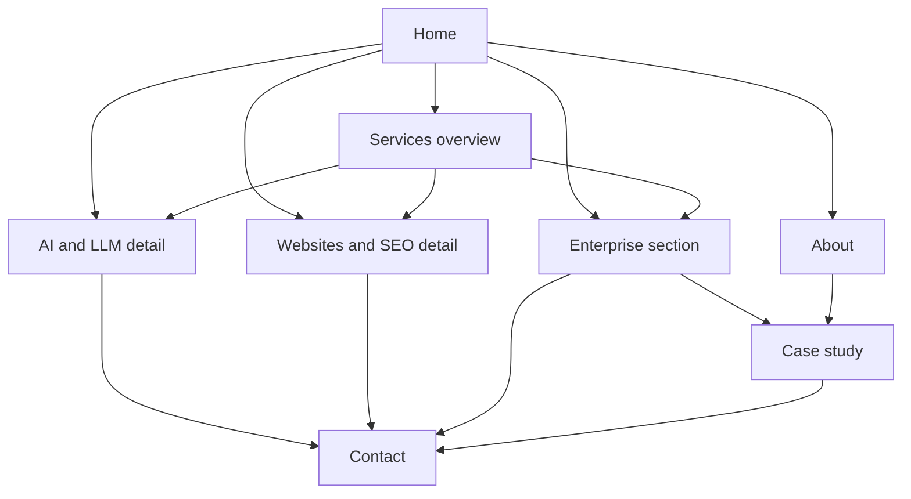

# Website content enhancement

Status: hybrid services plan, 28 October 2026. Living requirements stay in `prd/niscorp-company-site.md`. Update that PRD to 1.4 and add a revision-log line before changing the build. `plan/niscorp-company-site.md` stays the original brief.

Source: `research-audit.txt` for contact, positioning, and page copy. The hybrid decision is this plan. Append that decision to the audit when a non-markdown edit is allowed. Drop the parts that do not help a visitor choose and reach the company.

## What changes for the visitor

The live site says NisCorp AI builds software and consults, then offers two directions at `/websites` and `/enterprise`. The hero in `app/page.tsx` is `company.heroLine` (“NisCorp AI builds software and consults”). Email in `data/company.json` is still `hello@example.com`. Phone and WhatsApp are already real.

New positioning, used on Home and in metadata:

AI-first full-stack engineering for operations. Design and ship modern web apps, enterprise systems, and practical AI (RAG, agents) that a team can keep using.

Hybrid services, not three peer top-level URLs and not one page with no detail URLs:

- `/services` introduces all three offers, with jump links.
- `/services/ai-llm` and `/services/websites` are the detail pages. They carry the distinct keywords, Service schema, scopes, and CTAs.
- Enterprise stays a full section on `/services#enterprise` for this pass. Do not add `/services/enterprise` yet. The unnamed case study still ships, and the enterprise section links to it. Promoting enterprise to its own URL is a later PRD change.

Routes stay explicit files. Do not add `app/offerings/[slug]`.

- `app/services/page.tsx`
- `app/services/ai-llm/page.tsx`
- `app/services/websites/page.tsx`
- `app/about/page.tsx`
- `app/case-studies/page.tsx`
- Remove `app/websites/page.tsx` and `app/enterprise/page.tsx` so those URLs are not a second copy.

`output: 'export'` in `next.config.ts` does not apply `redirects()`. Add `vercel.json` permanent redirects: `/websites` to `/services/websites`, `/enterprise` to `/services#enterprise`. Note in the PRD that a Hostinger upload of `out/` needs the same two rules on that host.

Header: logo goes Home. Then Services, About, Contact. Services is a disclosure (summary plus links), not a hover-only menu, so it works on touch and keyboard. The links are AI & LLM and Websites & SEO. Enterprise is not in that menu, because it has no page. Case studies stay out of the header. `components/Header.tsx` nav is hardcoded today.

Footer lists the three offers with the same hrefs as the home cards, plus About, the case study, and contact. `components/Footer.tsx` already maps offerings, so each record needs an `href`. Enterprise href is `/services#enterprise`.

Aperio does not appear, as a name or a link. The case study is “B2B operations platform”. Do not add PowerBuddy, PowerSchool, other employers, the 35% claim, testimonials, logos, counters, prices, or a screenshot. There is no project image in the repo.

## Pages

### Home `/`

Order: hero, three direction cards, trust strip, process, FAQ, contact.

- Display line stays “Choose the work.”
- H1: “Build software and practical AI for how your team already works”.
- Subhead: design and deliver web apps, enterprise systems, and AI assistants that reduce manual work and make status clear, then leave a system the team can own.
- Cards once. Remove the second “Two ways we work” block so the same three links are not repeated.
- Card targets: AI `/services/ai-llm`, Websites `/services/websites`, Enterprise `/services#enterprise`.
- Short “About the founder” link to `/about`. Do not paste the bio into the hero.

### Services `/services`

H1: Services.

Intro: We design and deliver modern web apps, enterprise systems, and practical AI. Plain-language proposals, fixed-scope sprints, weekly demos, and a clean handover.

Jump links to `#ai-llm`, `#websites`, and `#enterprise`. Each target uses `scroll-mt` so the sticky header does not cover the heading.

- `#ai-llm` is a teaser: RAG applications, internal assistants, agentic workflows, Bedrock/OpenAI, OpenSearch or Snowflake, LangChain/LangGraph, AWS Serverless/Next.js. CTA: Explore AI & LLM Solutions → `/services/ai-llm`. Do not paste QuickStart, Pilot, and Production here.
- `#websites` is a teaser: messaging, contact and booking, analytics, on-page SEO, Google Business Profile, schema, launch in 14 days. CTA: See Websites & SEO → `/services/websites`. Packages stay on the detail page.
- `#enterprise` is the full offer: the teaser lead (purpose-built operations software, fewer manual handoffs, clearer status, integrations) plus the audit’s enterprise sections (what this is, typical projects, how we work, tech focus) and the four engagement tiles (Discovery, Design, Build, Transition). CTA: Discuss your operation — Book a call → `/contact`. Link to `/case-studies`.

Title: `Services — AI & LLM, Enterprise Software, Websites & SEO | NisCorp AI`

Description: Practical AI (RAG, agents), operations software, and fast websites with SEO. Plain-language proposals, fixed-scope sprints, weekly demos.

No Service JSON-LD on this URL. The enterprise block is a section, not its own Service entity, until it has a page.

### AI & LLM `/services/ai-llm`

H1: AI & LLM Solutions — RAG, agents, and automation that ship.

Body from the audit’s AI object: what we build, how it works, stack, outcomes. Engagement shapes: QuickStart (2 weeks), Pilot (4–6 weeks), Production (8–12 weeks). No fees.

The data-protection FAQ can sit here. Do not copy the full three-question home FAQ onto this page.

Service JSON-LD. CTA row: discovery call and WhatsApp.

### Websites & SEO `/services/websites`

H1: Websites & SEO for individuals and small teams.

Body from the audit’s websites object, including doctors, consultants, therapists, coaches, and independent practices. SEO and digital marketing stay named. Do not write “limited” in front of them.

Engagement shapes: Essentials (1–2 weeks), Growth (3–4 weeks), Care plan (monthly). Durations only.

Service JSON-LD. CTA: Get your site live in 14 days — Book a call → `/contact`.

### About `/about` and case study `/case-studies`

Unchanged from the prior decision. About uses the audit’s founder JSON: Shiva Prasad S, cross-geography engineering, web apps and production AI, IST and US time zones, plain-language proposals, fixed-scope sprints, weekly demos. No LinkedIn or GitHub until real URLs are in JSON.

Case study: context, problem, approach, impact, stack (Next.js, Supabase, TypeScript, GitHub Actions). Close with `/services#enterprise` and `/contact`.

### Contact `/contact`

Reply within one business day. Phone `+91 9535206010`. Email `shivp.102@gmail.com`. WhatsApp uses the same number.

Form path adds “AI and LLM work” beside the website, enterprise, and something-else options in `app/contact/ContactForm.tsx`. The form still does not post. It still opens WhatsApp or email on the device.

## Components that earn their place

Keep the current visual roles in the PRD. Off-white ground, near-black text, one accent, WhatsApp green only on WhatsApp, the ten languages on their current surfaces.

- **Hero actions.** Primary label: “Book a 20-minute discovery call”. It links to `/contact`. Secondary stays WhatsApp via `components/ContactActions.tsx` / `buildWhatsAppUrl`. Add optional `calendarUrl` on company JSON. Render an external booking link only when that value is a real `https` URL. The audit’s `https://calendar.app/your-scheduling-link` is not real, so leave the field empty.
- **Three direction cards.** `components/DirectionCards.tsx` is a two-column grid: glass for websites, clay for enterprise. Make it three columns from `md` up, stacked on small screens. Read `href` from the offering instead of assuming `/${slug}`. AI card: paper fill and a 2px near-black border so the three choices stay distinct. Do not give it glass, clay, or the maximalist hue.
- **Services disclosure.** A `details`/`summary` in the header. No hover-only dropdown and no new client menu state. Summary label “Services”. Two links inside.
- **Trust strip.** Three short facts under the hero: 16+ years shipping enterprise SaaS across EdTech, retail, and traffic engineering; hands-on with React/Next.js, Node.js, AWS Serverless, and Snowflake; production AI with RAG, OpenSearch, Bedrock/OpenAI, and LangChain/LangSmith. One line each. The PRD change allows these supplied experience lines. Invented customers and rankings stay out.
- **Engagement shapes.** Scannable scope cards, not a pricing table. AI shapes on the AI page. Website packages on the websites page. Enterprise tiles only inside `#enterprise`.
- **FAQ list.** Native `details`/`summary`, three questions on Home: engagement model, deployment and handover, data protection on AI work. FAQPage JSON-LD on Home only. The AI page may repeat the data-protection answer in its own section without a second FAQPage. No accordion library.
- **Case study layout.** One article, as above.

## Copy and data

- Email `shivp.102@gmail.com`. Phone stays `+91 9535206010`. `siteUrl` stays `https://niscorpai.com`.
- `data/offerings.json` records: `slug`, `title`, `summary`, `href`, `detail` (boolean), optional `metaTitle` / `metaDescription` / `sections` / `shapes`, and an `overview` paragraph for the services page. Enterprise has `detail: false` and the longer sections. AI and websites have `detail: true` and a short `overview`.
- `data/company.json`: email, hero, about, services meta, `trustFacts`, empty `calendarUrl`. Optional `gaMeasurementId` left empty.
- `data/faqs.json`, `data/case-studies.json`.
- `lib/data.ts`: types and readers. Still build-time `fs` only. Still no server action.

## Leave out of this build

- `/services/enterprise`.
- Gated PDFs and a 7-day content plan. There is no inbox to collect addresses.
- A blog, newsletter, pricing table, testimonial carousel, logo bar, or counters.
- Article, Product, HowTo, LocalBusiness, and Review JSON-LD.
- A fake calendar button and a placeholder project image.
- GA4 until a measurement ID is supplied. When it is, events are the discovery CTA, WhatsApp clicks, and the form’s WhatsApp and email actions. Do not invent an ID. Google Business Profile is an off-site listing, not a page.

## Files

PRD and plan:

- `prd/niscorp-company-site.md` — positioning, hybrid IA, pages, redirects, contact paths, visual note for the AI card, FAQPage on Home, Service schema only on the two detail pages, optional `calendarUrl`, founder and experience lines that come from JSON, sitemap routes, acceptance checks, revision 1.4. Record `/services/enterprise` as out until a later revision.
- `plan/website-content-enhancement.md` — this plan.
- Cursor rules that still lock the site to four pages, ban a founder name, ban year claims, and ban FAQ schema: `.cursor/rules/product-manager.mdc`, `content-creator.mdc`, `brand-guardian.mdc`, `ux-architect.mdc`, `ui-designer.mdc`. Point them at the PRD. Aperio stays unnamed.

UI:

- New: `components/TrustStrip.tsx`, `components/EngagementShapes.tsx`, `components/FaqList.tsx`.
- Update: `components/DirectionCards.tsx`, `components/Header.tsx`, `components/Footer.tsx`, `app/page.tsx`, contact form.
- New pages listed above. One offering layout component for the two detail pages, with a shapes slot. The services overview is its own page, because enterprise is a section there and the other two blocks are teasers.
- `vercel.json` for the two permanent redirects.

`next-sitemap` already runs after `next build`. Do not add `app/sitemap.ts` or `app/robots.ts`.

## Check

Walk Home, Services (including the three anchors), AI, Websites, About, Case studies, and Contact in the browser, including a narrow viewport. Open Services from the header with keyboard and by touch.

- Home cards and overview CTAs land on the detail pages or `#enterprise`.
- `/websites` and `/enterprise` redirect and are not in the sitemap.
- Email, phone, and WhatsApp use `company.json`. Discovery call goes to Contact. No dead calendar URL.
- Form path includes AI and LLM. Submit still opens WhatsApp or email and does not post.
- Search the built pages for “Aperio”, “example.com”, “PowerSchool”, and “PowerBuddy”. None should appear.
- View source: one `h1` per page, unique title and description, Organization on Home, Service on the two detail pages, FAQPage on Home, no ratings.
- After `next build`, `out/sitemap.xml` lists `/`, `/services`, `/services/ai-llm`, `/services/websites`, `/about`, `/case-studies`, and `/contact`.
