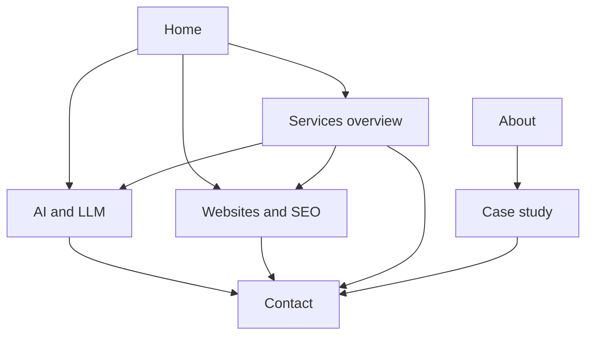

# PRD: NisCorp AI company site

|            |                                                                                   |
| ---------- | --------------------------------------------------------------------------------- |
| Status     | Draft. Do not start the app until a coding agent is asked to implement this file. |
| Version    | 1.6                                                                               |
| Updated    | 29 October 2026                                                                   |
| Source     | `plan/niscorp-company-site.md`, then `plan/website-content-enhancement.md`        |
| Supersedes | Those plans, for requirements. The plans stay as the briefs.                      |

This is the requirements document to refer to and update. When a requirement changes, edit the section below and add a line to the revision log. v1 stays inside this file.

The visitor’s job is to recognize that NisCorp AI builds software, practical AI, and consults, choose an offer, and reach the company. The offers are AI and LLM work, websites and SEO, and enterprise software.

## Positioning

NisCorp AI designs and ships modern web apps, enterprise systems, and practical AI (RAG, agents) that a team can keep using. This website is the company. Aperio is a separate product site later. This site does not name Aperio, link to it, or give it a section.

Three offers make the work concrete:

- **AI and LLM.** RAG applications, internal assistants, agentic workflows, evaluation, and handover. This offer has its own page.
- **Websites and SEO.** Sites for a person and their practice or private work. A doctor’s practice is one kind of client, written inside the websites page, not as its own brand. SEO and digital marketing are named as services. The page says what the client gets: a site that explains who they are, a clear way for people to reach them, and search and marketing set up around that site. This offer has its own page.
- **Enterprise software.** Software built for a company to improve how it runs its operations. For this revision it is a section on the services overview, not its own URL. No product name. One unnamed case study may describe a B2B operations platform.

Tone is specific and calm. Name the work and the result. Leave out hype, fake proof, public apologies that shrink the offer, the word “limited” in front of SEO or marketing, partners, subcontractors, and other firms. Do not invent an email, phone number, address, domain, calendar link, or social profile. Home and About speak as **NisCorp AI the company**. Do not use individual names, founder bios, or personal résumé lines on any page. Copy for Home and About lives in `data/company.json` and `data/about.json`. Do not add employer names, client names, or rankings.

## v1 scope

In this revision: Home, a services overview, two service detail pages, About, one case study, and Contact. Three contact actions, and a form that opens WhatsApp or email on the visitor’s device.

Out until this PRD moves the item in:

- Aperio, by name or by section
- `/services/enterprise` as its own page
- A product catalog and dynamic `[slug]` offering routes
- CSV ingestion and `papaparse`
- App Router `app/sitemap.ts` and `app/robots.ts`
- Blog, pricing table, testimonials, client logos, counters, newsletter, gated PDFs
- Any server, database, route handler, server action, or third-party form backend
- Review or AggregateRating JSON-LD, and any claim of customers or rankings
- Article, Product, HowTo, or LocalBusiness schema
- Downloading or reskinning a theme
- Keyword clusters, link building, hreflang, and programmatic SEO
- Dark mode
- GA4, until `gaMeasurementId` in `data/company.json` is a real measurement ID
- A calendar button that points at a placeholder URL

Routes stay explicit files. Offering copy stays in JSON. Do not add `app/offerings/[slug]`.

## Information architecture



Header and footer on every page. The header is logo (Home), a Services menu, About, and Contact. The menu lists All services, AI and LLM, and Websites and SEO. It opens from the keyboard and from a tap, closes on an outside click and on Escape, and does not rely on hover alone. Case studies stay out of the header. The footer is four columns in one row: the mark and a one-sentence tagline with the copyright under it, the three offers, Company (About and the case study), and Support (a link to Contact). Phone, email, and WhatsApp stay on the contact actions above the footer, not repeated as plain text under it. Contact actions use a quiet label-and-value layout, not heavy card boxes. WhatsApp green is only the WhatsApp button. A floating WhatsApp button sits on every page.

Home order: hero (company line, H1, subhead, CTAs, company intro, three direction cards), **What we're good at** from `trustFacts`, how a project starts, FAQ, contact. The direction cards are not repeated lower on the page.

## Pages

### Home `/`

- First viewport: the company line (`heroLine`), H1, subhead (`heroSubhead`), discovery-call action, WhatsApp, company intro (`companyIntro`), and the three direction cards.
- Cards use `href` from `data/offerings.json`: AI to `/services/ai-llm`, websites to `/services/websites`, enterprise to `/services#enterprise`.
- **What we're good at:** capability lines from `trustFacts` (stack and delivery themes, not a founder résumé).
- **How a project starts:** `processSteps` and a short company snippet from `about`, with a link to About labeled **About NisCorp AI**.
- FAQ from `data/faqs.json`, with FAQPage JSON-LD.
- Phone, email, and WhatsApp.

Primary action: book a 20-minute discovery call. That links to `/contact` until `calendarUrl` is a real `https` URL.

### Services `/services`

H1 is Services. Intro from `servicesIntro`. Jump links to `#ai-llm`, `#websites`, and `#enterprise`.

AI and websites blocks are teasers with a link to the detail page. Enterprise is the full offer: sections, engagement shapes, a link to the case study, and a discovery-call action. No Service JSON-LD on this URL.

### AI and LLM `/services/ai-llm`

RAG, agents, scopes, stack, and outcomes. Engagement shapes name durations, not fees. Service JSON-LD. The data-protection answer may appear here without a second FAQPage.

Primary action: book a discovery call.

### Websites `/services/websites`

Websites and SEO, with SEO and digital marketing named as services. State what the client gets, as in Positioning. Packages name durations, not fees. Service JSON-LD.

Primary action: book a call to get a site live.

### About `/about`

Company-first copy from `data/about.json`: title **About NisCorp AI**, summary, and sections for what we do, how we work, capabilities, principles, where we work (remote-first, IST and US coverage at company level), and get in touch. No individual names or founder section. No social links until real URLs are in JSON. Link to the case study. Same contact close.

### Case studies `/case-studies`

One unnamed B2B operations platform: context, problem, approach, impact, stack. No screenshot. Close with links to `/services#enterprise` and Contact.

### Contact `/contact`

Phone, email, WhatsApp, and a short form: name, email, path, message. Paths: AI and LLM work, an individual website, enterprise software, or something else. The page says we reply within one business day.

One line says the message opens in WhatsApp or email on the visitor’s device.

Primary action: send the message through WhatsApp or email.

### Retired routes

`/websites` and `/enterprise` are not pages. `vercel.json` permanently redirects `/websites` to `/services/websites` and `/enterprise` to `/services#enterprise`. A Hostinger upload of `out/` needs the same two rules on that host, because `output: 'export'` does not apply `redirects()` in `next.config.ts`.

## Contact behavior

The site cannot receive a form into an inbox by itself. There is no form backend. All three links come from `data/company.json`.

| Action             | Behavior                                                                                                            |
| ------------------ | ------------------------------------------------------------------------------------------------------------------- |
| Phone              | `tel:` link. The number is shown as people dial it.                                                                 |
| Email              | `mailto:` link. The address is shown on the page.                                                                   |
| WhatsApp           | `https://wa.me/<E.164 without plus>?text=...`. A tap opens the WhatsApp app on a phone and WhatsApp Web on desktop. |
| Floating button    | Same number and the default message from `whatsappDefaultText`.                                                     |
| Form submit        | Does not post. Opens WhatsApp with the visitor’s name, path, and message filled in.                                 |
| Second form action | Opens the same text in the visitor’s email app.                                                                     |

Real phone, email, and `siteUrl` live in `data/company.json`. `calendarUrl` stays empty until it is a real `https` booking link. The discovery-call control uses that URL when it is present, and `/contact` otherwise.

## Visual requirements

The UI is modern and composed. The first viewport shows the company line and the three directions as peer choices. A pale unstyled document or a default template fails.

Ten design languages are in scope. Each has one job so the choice stays readable:

- **Minimalism** carries the company line: large type, a short measure, and whitespace around the choice.
- **Bento grid** is the home structure. The hero spans the grid. The three directions are peer cells. Process, FAQ, and contact fill the rest. Offering pages use the same grid at a smaller density.
- **Glassmorphism** is the header and the websites direction card: a translucent fill, a 16px blur, and a 1px light border.
- **Claymorphism** is the enterprise direction card and enterprise section cards on `/services`: a soft radius, inner shadow, and a **muted warm paper** pastel that still clears WCAG 2.2 AA with the text—not a loud terracotta fill.
- The AI direction card is paper fill with a 2px near-black border. AI detail sections on `/services/ai-llm` use a quiet frosted glass surface. They do not use clay or the maximalist hue.
- **Neomorphism** is only the three process tiles. Labels are near-black on a surface close to the page ground.
- **Spatial UI** puts the company line above a liquid shape. Cards lift on hover and on focus.
- **Liquid glass** is one organic shape behind the home hero. Scroll moves it. Inner pages may use a **still, smaller** echo behind the page title (lower opacity, no scroll travel, no morph). `prefers-reduced-motion: reduce` freezes morph and scroll-driven motion.
- **Skeuomorphism** is a light paper grain on the page background.
- **Maximalism** is one display line in the hero: weight, tracking, and a second hue. It does not spread into body copy.
- **Brutalism** is not used on the contact form in this revision. The contact form and shared contact row use the same quiet **glass** family as other softened surfaces: rounded panel, sentence-case labels, and reachable fields.

Other visual rules:

- Off-white paper ground and near-black text. One accent marks emphasis and the primary path. A second hue is allowed only on the maximalist display line.
- WhatsApp green only on the WhatsApp control.
- Tailwind is the styling system. shadcn/ui components are copied into `components/ui` and styled to this system. They are source in this repo, not a downloaded theme.
- Text on glass, clay, and neo surfaces meets WCAG 2.2 AA. Focus stays visible.
- Mobile-first. On a narrow viewport the header, the three direction cards, and the floating button remain usable. The button does not cover those actions.

Leave out dark mode, downloaded or reskinned themes, counters, logo bars, testimonial carousels, pricing tables, and placeholder portfolios.

## SEO requirements

Each page exports a unique title and description from the JSON, plus Open Graph title and description. One `h1` per page, then semantic headings. The static HTML includes the title, description, and JSON-LD in the page source.

JSON-LD:

- Home: Organization with name, url, email, and telephone. `url` is `siteUrl`. FAQPage for the home questions.
- `/services/ai-llm` and `/services/websites`: Service, using that offering’s name and description.
- No Service entity for the enterprise section until it has its own URL.
- No Review or AggregateRating.

Sitemap and robots come from `next-sitemap` after the production build, written into `out/`.

- `next-sitemap.config.js` sets `siteUrl` from `data/company.json`, `generateRobotsTxt: true`, and `outDir: './out'`.
- `package.json` has `"postbuild": "next-sitemap"`.
- `out/sitemap.xml` lists `/`, `/services`, `/services/ai-llm`, `/services/websites`, `/about`, `/case-studies`, and `/contact`.
- `out/sitemap.xml` does not list `/websites` or `/enterprise`.
- `out/robots.txt` points at that sitemap.

Do not add `app/sitemap.ts` or `app/robots.ts`. Those files would emit a second pair.

## Source control

Each story is committed on its own branch, and every branch starts from `main`. The agent does not open the pull request and does not merge. A human opens the pull request and merges it into `main`. The next story does not start until that merge is on `main`.

Branch names: `nis-1-choose-a-direction`, `nis-2-reach-the-company`, `nis-3-crawlable-release`.

A commit runs ESLint and Prettier through the pre-commit hook. A commit that fails the hook is not done.

## Technical requirements

Static Next.js site. No Node server is required to serve the result. `output: 'export'` is required so the same build can be served by Vercel or uploaded as static files. Pushing JSON or code rebuilds the pages. Nothing runs at request time.

- Next.js App Router, TypeScript, Tailwind CSS.
- Content is JSON, read with Node `fs` at build time in `lib/data.ts`. Import that module only from server components and metadata functions.
- `images.unoptimized: true` when `next/image` is used. Skip the image component until there are real assets.
- The contact form is a client component and receives the company contact fields as props.

### Files

```text
app/
  layout.tsx
  page.tsx
  services/page.tsx
  services/ai-llm/page.tsx
  services/websites/page.tsx
  about/page.tsx
  case-studies/page.tsx
  contact/page.tsx
  contact/ContactForm.tsx
  globals.css
components/
  Header.tsx
  ServicesMenu.tsx
  Footer.tsx
  WhatsAppButton.tsx
  DirectionCards.tsx
  ContactActions.tsx
  DiscoveryLink.tsx
  TrustStrip.tsx
  EngagementShapes.tsx
  FaqList.tsx
  OfferingDetail.tsx
  LiquidGlass.tsx
  ui/
data/
  company.json
  offerings.json
  about.json
  faqs.json
  case-studies.json
lib/
  data.ts
public/
next.config.ts
next-sitemap.config.js
vercel.json
```

### `data/company.json`

Fields include `name`, `email`, `phoneDisplay`, `phoneTel`, `whatsappE164`, `whatsappDefaultText`, `siteUrl`, home and contact and services metadata, `heroLine`, `heroSubhead`, `companyIntro`, `about` (short company snippet for the process block on Home), `processSteps`, `trustFacts` (capability lines for **What we're good at**), `calendarUrl`, and `gaMeasurementId`. `next-sitemap` reads `siteUrl`. `calendarUrl` and `gaMeasurementId` may be empty.

### `data/about.json`

Fields include `title`, `summary`, `metaTitle`, `metaDescription`, and `sections` (each with `heading` and `paragraphs`). Content is company-first: capabilities, principles, working style, and coverage—no founder or individual names.

### `data/offerings.json`

Three records: `ai-llm`, `websites`, and `enterprise`. Each record has `slug`, `title`, `summary`, `href`, `detail`, `overview`, `overviewCta`, metadata, `sections`, and `shapes`. Home reads `summary` and `href`. Only records with `detail: true` have their own page.

## Hosting

Not part of the first coding task. When the site is deployed:

- Domain and business email stay on Hostinger (`info@` or the address in `company.json`).
- Preferred site host is Vercel, on a plan that allows commercial use. The Hobby plan is for personal projects.
- DNS at Hostinger points the domain at that host.
- The static `out/` folder can instead be uploaded to Hostinger if one bill is preferred. Expect a manual upload or a GitHub Action, and regional rather than global edge caching.

## Still required before publish

- A real `calendarUrl`, if the discovery call should open a scheduler
- Production DNS, when the domain is ready
- The two redirects on any host that does not read `vercel.json`

## Acceptance

Run the production build and open the static output. Walk Home, Services, AI, Websites, About, Case studies, and Contact.

- The company reads as software, practical AI, and consulting. Home and About do not name an individual or show a founder bio.
- Aperio does not appear. Neither do PowerSchool or PowerBuddy.
- SEO and digital marketing read as services on the websites page.
- Phone, email, and WhatsApp links use `company.json`. The email is not `hello@example.com`.
- The discovery call goes to Contact while `calendarUrl` is empty.
- The floating button and the form open a prefilled WhatsApp chat. The email action opens a prefilled message. The form does not post. The path list includes AI and LLM work.
- View source shows full HTML, a unique title and description per page, Organization and FAQPage on Home, Service on the two detail pages, and no ratings.
- After `next build`, `out/sitemap.xml` lists `/`, `/services`, `/services/ai-llm`, `/services/websites`, `/about`, `/case-studies`, and `/contact`. It does not list `/websites` or `/enterprise`. `out/robots.txt` references the sitemap.
- The first viewport shows the company line and the three directions. The ten design languages from Visual requirements are each present in their assigned role, and the AI card uses the paper rule. The choice stays obvious.
- A narrow viewport still shows the header, the three direction cards, and the floating button without covering the main actions. The Services menu opens from the keyboard and from a tap, closes on an outside click, and does not block the main actions when dismissed.

## Revision log

| Version | Date            | Change                                                                                                                                          |
| ------- | --------------- | ----------------------------------------------------------------------------------------------------------------------------------------------- |
| 1.0     | 28 October 2026 | Initial PRD, written from `plan/niscorp-company-site.md`.                                                                                       |
| 1.1     | 28 October 2026 | Stories stay on their own branches and are not merged to `main`. Commits run ESLint and Prettier.                                               |
| 1.2     | 28 October 2026 | Every story branch starts from `main`. A human opens the pull request and merges it before the next story starts.                               |
| 1.3     | 28 October 2026 | Visual system is a ten-language blend. Copied shadcn/ui components are in scope. Dark mode and downloaded themes stay out.                      |
| 1.4     | 28 October 2026 | Hybrid services: overview, AI and websites detail pages, enterprise as a section, About, one unnamed case study, FAQPage, and supplied contact. |
| 1.5     | 28 October 2026 | Footer is a four-column row with a small mark. Contact actions share one card; WhatsApp green is only its button.                                |
| 1.6     | 29 October 2026 | Company-first Home and About copy in JSON; **What we're good at** on Home; Services menu with outside dismiss; muted enterprise clay; contact and AI detail use quiet glass; still title glass on inner pages. |
