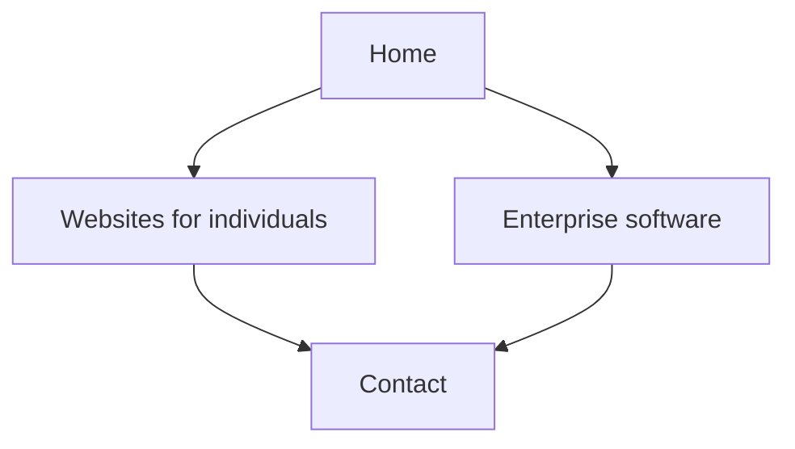

# PRD: NisCorp AI company site

|            |                                                                                   |
| ---------- | --------------------------------------------------------------------------------- |
| Status     | Draft. Do not start the app until a coding agent is asked to implement this file. |
| Version    | 1.3                                                                               |
| Updated    | 28 October 2026                                                                   |
| Source     | Written from `plan/niscorp-company-site.md`                                       |
| Supersedes | That plan, for requirements. The plan stays as the original brief.                |

This is the requirements document to refer to and update. When a requirement changes, edit the section below and add a line to the revision log. v1 stays inside this file.

The visitor’s job is to recognize that NisCorp AI builds software and consults, choose a direction, and reach the company. The two directions are an individual website, or enterprise software.

## Positioning

NisCorp AI builds software solutions and consults on that work. This website is the company. Aperio is a separate product site later. This site does not name Aperio, link to it, or give it a section.

The company line stays general. Two examples make it concrete:

- **Websites for individuals.** Sites for a person and their practice or private work. A doctor’s practice is one kind of client, written inside the websites page, not as its own brand. SEO and digital marketing are part of this work and are named as services. The page says what the client gets: a site that explains who they are, a clear way for people to reach them, and search and marketing set up around that site.
- **Enterprise software.** Software built for a company to improve how it runs its operations. The page describes the engagement: understand the operation, build the software around it, and leave the team with a system they use. No product name.

Tone is specific and calm. Name the work and the result. Leave out hype, fake proof, public apologies that shrink the offer, the word “limited” in front of SEO or marketing, partners, subcontractors, and other firms. Do not invent an email, phone number, address, domain, or founder name.

## v1 scope

In v1: four static pages, two offerings, three contact actions, and a form that opens WhatsApp or email on the visitor’s device.

Out of v1 until this PRD moves the item in:

- Aperio, by name or by section
- A product catalog and dynamic `[slug]` offering routes
- CSV ingestion and `papaparse`
- App Router `app/sitemap.ts` and `app/robots.ts`
- Blog, pricing table, team page, testimonials, client logos, counters, newsletter
- Any server, database, route handler, server action, or third-party form backend
- Review or AggregateRating JSON-LD, and any claim of customers, years, or rankings
- Downloading or reskinning a theme
- Keyword clusters, link building, hreflang, programmatic SEO, and Article, Product, FAQ, or HowTo schema
- Dark mode

Add `app/offerings/[slug]` only when a third offering exists. Until then the four routes stay explicit, and offering copy stays in JSON.

## Information architecture



Header and footer on every page. The footer repeats the two examples and phone, email, and WhatsApp. A floating WhatsApp button sits on every page.

Home order: hero, short about, the two services, contact.

## Pages

### Home `/`

- First viewport: NisCorp AI builds software and consults, plus the two directions.
- Two example cards, using the summaries from `data/offerings.json`.
- A short sequence: you tell us the work, we propose it, we build it.
- Phone, email, and WhatsApp.

Primary action: choose one of the two directions.

### Websites `/websites`

Websites for individuals, with SEO and digital marketing named as services. State what the client gets, as in Positioning. Close with the same three contact actions.

Primary action: contact about an individual website.

### Enterprise `/enterprise`

Enterprise software that improves operations. Describe the engagement. No product name. Same contact close.

Primary action: contact about enterprise software.

### Contact `/contact`

Phone, email, WhatsApp, and a short form: name, email, path, message. Paths: an individual website, enterprise software, or something else.

One line says the message opens in WhatsApp or email on the visitor’s device.

Primary action: send the message through WhatsApp or email.

## Contact behavior

The site cannot receive a form into an inbox by itself. There is no form backend. All three links come from `data/company.json`.

| Action             | Behavior                                                                                                            |
| ------------------ | ------------------------------------------------------------------------------------------------------------------- |
| Phone              | `tel:` link. The number is shown as people dial it.                                                                 |
| Email              | `mailto:` link. The address is shown on the page.                                                                   |
| WhatsApp           | `https://wa.me/<E.164 without plus>?text=...`. A tap opens the WhatsApp app on a phone and WhatsApp Web on desktop. |
| Floating button    | Same number and the default message from `whatsappDefaultText`.                                                     |
| Form submit        | Does not post. Opens WhatsApp with the visitor’s name, path, and message filled in.                                 |
| Second form action | Opens the same text in the visitor’s email app.                                                                     |

Until real values are supplied, `data/company.json` holds obvious placeholders: `hello@example.com`, `910000000000`, and `https://example.com` for `siteUrl`.

## Visual requirements

The UI is modern and composed. The first viewport shows the company line and the two directions as peer choices. A pale unstyled document or a default template fails.

Ten design languages are in scope. Each has one job so the choice stays readable:

- **Minimalism** carries the company line: large type, a short measure, and whitespace around the choice.
- **Bento grid** is the home structure. The hero spans the grid. The two directions are peer cells. About, process, and contact fill the rest. Offering pages use the same grid at a smaller density.
- **Glassmorphism** is the header and the websites direction card: a translucent fill, a 16px blur, and a 1px light border.
- **Claymorphism** is the enterprise direction card: a soft radius, an inner shadow, and a pastel that still clears WCAG 2.2 AA with the text.
- **Neomorphism** is only the three process tiles. Labels are near-black on a surface close to the page ground.
- **Spatial UI** puts the company line above a liquid shape. Cards lift on hover and on focus.
- **Liquid glass** is one organic shape behind the hero. Scroll moves it. `prefers-reduced-motion: reduce` freezes it.
- **Skeuomorphism** is a light paper grain on the page background.
- **Maximalism** is one display line in the hero: weight, tracking, and a second hue. It does not spread into body copy.
- **Brutalism** is the contact form frame: a hard border, square corners, and a system font on the labels. Fields stay labeled and keyboard-reachable.

Other visual rules:

- Off-white paper ground and near-black text. One accent marks emphasis and the primary path. A second hue is allowed only on the maximalist display line.
- WhatsApp green only on the WhatsApp control.
- Tailwind is the styling system. shadcn/ui components are copied into `components/ui` and styled to this system. They are source in this repo, not a downloaded theme.
- Text on glass, clay, and neo surfaces meets WCAG 2.2 AA. Focus stays visible.
- Mobile-first. On a narrow viewport the header, both example cards, and the floating button remain usable. The button does not cover those actions.

Leave out dark mode, downloaded or reskinned themes, counters, logo bars, testimonial carousels, pricing tables, and placeholder portfolios.

## SEO requirements

Each page exports a unique title and description from the JSON, plus Open Graph title and description. One `h1` per page, then semantic headings. The static HTML includes the title, description, and JSON-LD in the page source.

JSON-LD:

- Home: Organization with name, url, email, and telephone. `url` is `siteUrl`, and stays the placeholder until a real domain exists.
- `/websites` and `/enterprise`: Service, using that offering’s name and description.

Sitemap and robots come from `next-sitemap` after the production build, written into `out/`.

- `next-sitemap.config.js` sets `siteUrl` from `data/company.json`, `generateRobotsTxt: true`, and `outDir: './out'`.
- `package.json` has `"postbuild": "next-sitemap"`.
- `out/sitemap.xml` lists `/`, `/websites`, `/enterprise`, and `/contact`.
- `out/robots.txt` points at that sitemap.

Do not add `app/sitemap.ts` or `app/robots.ts`. Those files would emit a second pair.

## Source control

Each story is committed on its own branch, and every branch starts from `main`. The agent does not open the pull request and does not merge. A human opens the pull request and merges it into `main`. The next story does not start until that merge is on `main`.

Branch names: `nis-1-choose-a-direction`, `nis-2-reach-the-company`, `nis-3-crawlable-release`.

A commit runs ESLint and Prettier through the pre-commit hook. A commit that fails the hook is not done.

## Technical requirements

Static Next.js site. No Node server is required to serve the result. `output: 'export'` is required so the same build can be served by Vercel or uploaded as static files. Pushing JSON or code rebuilds the pages. Nothing runs at request time.

- Next.js App Router, TypeScript, Tailwind CSS.
- Content is JSON, read with Node `fs` at build time in `lib/data.ts`. Import that module only from server components and metadata functions.
- `images.unoptimized: true` when `next/image` is used. Skip the image component until there are real assets.
- The contact form is a client component and receives the company contact fields as props.

### Files

```text
app/
  layout.tsx
  page.tsx
  websites/page.tsx
  enterprise/page.tsx
  contact/page.tsx
  contact/ContactForm.tsx
  globals.css
components/
  Header.tsx
  Footer.tsx
  WhatsAppButton.tsx
  DirectionCards.tsx
  ContactActions.tsx
  LiquidGlass.tsx
  ui/
data/
  company.json
  offerings.json
lib/
  data.ts
public/
next.config.ts
next-sitemap.config.js
```

### `data/company.json`

Fields: `name`, `email`, `phoneDisplay`, `phoneTel`, `whatsappE164`, `whatsappDefaultText`, and `siteUrl`. `next-sitemap` reads `siteUrl`.

### `data/offerings.json`

Two records. Each record has `slug` (`websites` or `enterprise`), `title`, `summary`, `metaTitle`, `metaDescription`, and the sections that page renders. Home reads the summaries for the two cards.

## Hosting

Not part of the first coding task. When the site is deployed:

- Domain and business email stay on Hostinger (`info@` or the address in `company.json`).
- Preferred site host is Vercel, on a plan that allows commercial use. The Hobby plan is for personal projects.
- DNS at Hostinger points the domain at that host.
- The static `out/` folder can instead be uploaded to Hostinger if one bill is preferred. Expect a manual upload or a GitHub Action, and regional rather than global edge caching.

## Still required before publish

- Contact email
- WhatsApp number with country code
- Production domain, when DNS is ready

## Acceptance

Run the production build and open the static output. Walk Home, Websites, Enterprise, and Contact.

- The company reads as software solutions and consulting.
- Aperio does not appear.
- SEO and digital marketing read as services on the websites page.
- Phone, email, and WhatsApp links use `company.json`.
- The floating button and the form open a prefilled WhatsApp chat. The email action opens a prefilled message. The form does not post.
- View source shows full HTML, a unique title and description per page, and JSON-LD without ratings.
- After `next build`, `out/sitemap.xml` lists the four routes and `out/robots.txt` references the sitemap.
- The first viewport shows the company line and the two directions. The ten design languages from Visual requirements are each present in their assigned role, and the choice stays obvious.
- A narrow viewport still shows the header, the two example cards, and the floating button without covering the main actions.

## Revision log

| Version | Date            | Change                                                                                                                     |
| ------- | --------------- | -------------------------------------------------------------------------------------------------------------------------- |
| 1.0     | 28 October 2026 | Initial PRD, written from `plan/niscorp-company-site.md`.                                                                  |
| 1.1     | 28 October 2026 | Stories stay on their own branches and are not merged to `main`. Commits run ESLint and Prettier.                          |
| 1.2     | 28 October 2026 | Every story branch starts from `main`. A human opens the pull request and merges it before the next story starts.          |
| 1.3     | 28 October 2026 | Visual system is a ten-language blend. Copied shadcn/ui components are in scope. Dark mode and downloaded themes stay out. |
